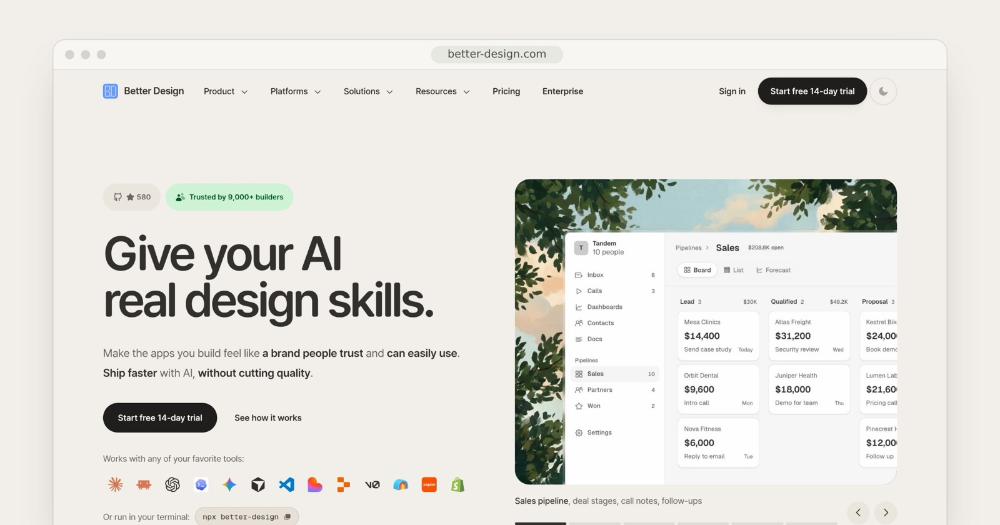

<a href="https://better-design.com/?utm_source=github&utm_medium=readme&utm_campaign=grand-eldorado-seat-view"></a>

> **Want to build something like this in the future? [Use our MCP!](https://better-design.com/?utm_source=github&utm_medium=readme&utm_campaign=grand-eldorado-seat-view)**

# Grand Eldorado seat view

Pick a seat in the Grand Eldorado hall at UGC De Brouckère, Brussels, and see the screen from it before you book.

**[Try it](https://ugc-de-brouckere.pages.dev/?utm_source=github&utm_medium=readme&utm_campaign=grand-eldorado-seat-view)**

- The hall is rebuilt in 3D, row by row, balcony included.
- Tap any seat to see its view, then tap the next one.

Built with three.js in one HTML file. This is a fan project, not a UGC product.

## Run it

Serve the folder with any static server, for example:

```bash
npx serve .
```

## Credits

Wall relief textures in `tex/` are crops of photos by AdriMela, Wikimedia Commons, [CC BY-SA 4.0](https://creativecommons.org/licenses/by-sa/4.0/). See `tex/CREDITS.txt`.
